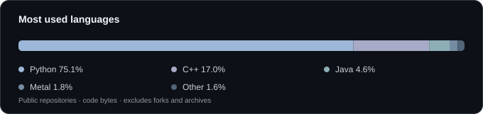

Computer Engineering @ <strong>University of Guelph</strong> Embedded systems @ <strong>Gryphon Formula Racing</strong> · Technical Director @ <strong>Google Developer Group</strong> Previously, AI training @ <strong>AfterQuery</strong>

 &nbsp; 

### [tinyinfer](https://github.com/iqureshi123/tinyinfer)

## 🛠️ Tech Stack

<strong>Languages</strong>

<strong>Frameworks &amp; Platforms</strong>

<strong>AI &amp; Agentic Tooling</strong>

  

## 📊 GitHub Stats

## 🤝 Connect

