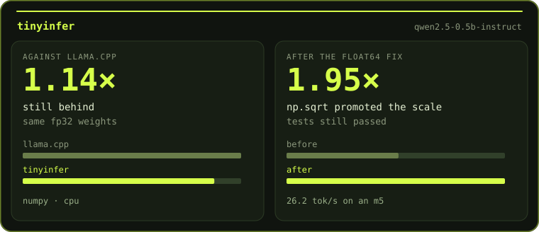

 &nbsp; 

## 👨‍💻 About Me

<a href="./about-dark.svg#gh-dark-mode-only"><picture><source media="(max-width:600px)" srcset="./about-mobile-dark.svg" /></picture></a><a href="./about-light.svg#gh-light-mode-only"><picture><source media="(max-width:600px)" srcset="./about-mobile-light.svg" /></picture></a>

## 🛠️ Tech Stack

<strong>Languages</strong>

<strong>Frameworks</strong>

<strong>Platforms &amp; Cloud</strong>

<strong>Tools</strong>

      

<strong>AI &amp; Agentic Tooling</strong>

    

## 📊 GitHub Stats

## 🤝 Connect

 &nbsp; 

### [tinyinfer](https://github.com/iqureshi123/tinyinfer)

